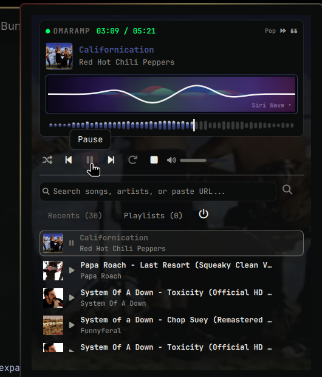

# Omaramp 📻

Native status bar retro music player controller and real-time audio visualizer for Omarchy.

Inspired by Winamp & [cliamp](https://github.com/brianstrauch/cliamp).

[](https://omarchyplugins.com)
[](LICENSE)



---

## 🌟 Features

- **Retro Winamp HUD**: Digital LED time counter (`01:23 / 03:45`), KBPS/Stereo badges, track marquee ticker, and smooth playhead scrubber.
- **40 Live Visualizer Styles**: Categorized selector featuring:
  - **Classic & VU**: Bars, Classic LED, Peaks, Columns, Bars Dot, Bars Outline, Bricks, Stereo VU (real left/right levels), ASCII.
  - **Waves & Scopes**: Siri Wave (Apple iOS 9 algorithm), Sine Wave (standing acoustic harmonics), SoundCloud Wave (ultra-thin asymmetrical), Telegram Wave (voice capsule pills), LED Scrubber (discrete matrix blocks), Heatmap Wave (thermal energy gradient), XY Scope, Waveform, Heartbeat.
  - **Synth & Retro**: Retro Synth, Flame, Pulse, Matrix, Terrain, Logo, Mosaic.
  - **Particles & Nature**: Sand, Firework, Geyser, Firefly, Sakura, Bubbles, Rain, Butterfly, Scatter.
  - **3D & GPU**: GPU Plasma, GPU Wormhole, GPU Lightning Orb, Oscilloscope Warp, CRT Radar Scope, 3D Cyber Tunnel.
- **10-Band Equalizer & DSP Effects**:
  - 10-Band Pro EQ presets: *Flat, Bass Boost, Rock, Electronic, Pop, Vocal Clarity, Acoustic, Treble Boost, Late Night*.
  - **3D Spatial Audio Widener**: Binaural stereo expansion.
  - **EBU R128 Dynamic Loudness Normalizer**: Anti-earblast volume evening.
- **Synced Lyrics**: Live word-by-word synced lyrics powered by lrclib.net.
- **Streaming & YouTube Integration**:
  - Instant YouTube track search with auto-thumbnail prefetching; **Show more results** loads ten more at a time.
  - Direct-stream audio playback with smart URL caching and prefetching.
  - Direct Spotify track links (`open.spotify.com/track/...`) and playlist/album importer.
- **Queue Manager (Up Next)**: Interactive queue tab with reordering, queue count badges, and auto-play next.
- **Plays on from any list**: Next, Previous and auto-play walk the list a song was started from: a playlist, the search results or Recents.
- **Full Transport Deck**: Play/Pause, Next, Prev, Stop, Shuffle, Repeat, Volume slider, and Speed controls (0.5x–2.0x).
- **Keyboard Shortcuts**: `Space` (play/pause), `Left`/`Right` (seek), `Up`/`Down` (volume), `/` (search), `m` (mute), `Esc` (close).
- **Spectrum capture**: Uses the default audio output’s monitor while playing or while the panel is open. Pausing or losing fresh audio frames clears the visualizer.
- **Status Bar Widget**: The icon stays one standard slot wide. It shows the selected visualizer during playback, even with the popup closed, and the classic four bars when paused, stopped, or waiting for audio. It can also display an elided track title on horizontal bars. Full track details remain in the tooltip.
  - **Left Click**: Toggle popup player panel.
  - **Middle Click**: Instant Play/Pause toggle.
  - **Right Click**: Skip to next track.
  - **Mouse Wheel**: Smooth volume adjustment directly from the bar.

---

## 📦 External Dependencies

Omaramp requires the following packages for audio playback, PipeWire recording, spectrum processing, and media streaming:

| Dependency | Purpose | Package (Arch Linux) |
| :--- | :--- | :--- |
| `mpv` | Headless media playback engine & IPC socket control | `mpv` |
| `pipewire` | Real-time audio server and recording (`pw-record`) | `pipewire` / `pipewire-pulse` |
| `python-numpy` | Zero-copy C fast Fourier transform (FFT) spectrum calculations | `python-numpy` |
| `yt-dlp` | YouTube track search and audio streaming | `yt-dlp` |

### Install Dependencies:

```bash
omarchy pkg add mpv pipewire python-numpy yt-dlp
```

---

## 📥 Installation

Install Omaramp using the Omarchy CLI:

```bash
omarchy plugin add https://github.com/JoeJoeflyn/omaramp --enable
omarchy restart shell
```

### Manual Bar Configuration

Add `"omaramp"` to your desired status bar section in `~/.config/omarchy/shell.json`:

```jsonc
{
  "bar": {
    "sections": {
      "right": [
        "omaramp",
        "omarchy.audio",
        "omarchy.network",
        "omarchy.battery"
      ]
    }
  }
}
```

---

## 🗑️ Removal & Uninstallation

To disable and remove Omaramp from your system:

```bash
# 1. Remove plugin from Omarchy
omarchy plugin remove omaramp

# 2. (Optional) Clean up cached album art and history
rm -rf ~/.config/omarchy/plugins/omaramp ~/.cache/omaramp

# 3. Restart the desktop shell
omarchy restart shell
```

---

## ⌨️ Shell / IPC Commands

Control Omaramp from your terminal, scripts, or window manager hotkeys. With the widget in the bar, playback commands work without opening the panel first:

```bash
# Toggle player panel
omarchy-shell shell summon omaramp
omarchy-shell shell toggle omaramp

# Playback controls
omarchy-shell omaramp play
omarchy-shell omaramp pause
omarchy-shell omaramp togglePlayback
omarchy-shell omaramp stop

# Navigation
omarchy-shell omaramp next
omarchy-shell omaramp prev

# Pick local songs, or play a file/folder without opening the panel first.
# You can also drop files/folders on the bar icon or click the folder next to Search.
# The first audio file plays; the rest are appended to Up Next.
omarchy-shell omaramp openFiles
omarchy-shell omaramp addFile "$HOME/Music/Album"

# Play a stream URL or YouTube link
omarchy-shell omaramp playUrl "https://www.youtube.com/watch?v=..."
```

---

## 📄 License

MIT License © 2026 JoeJoeflyn
